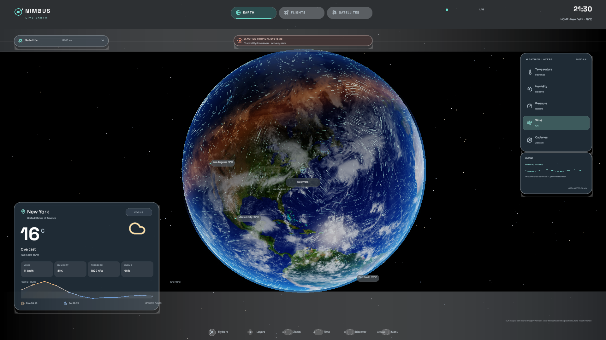
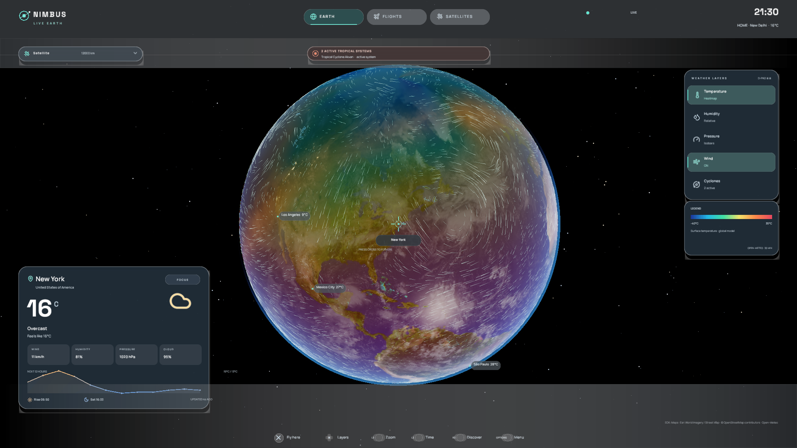
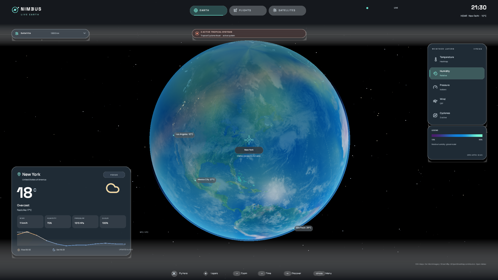
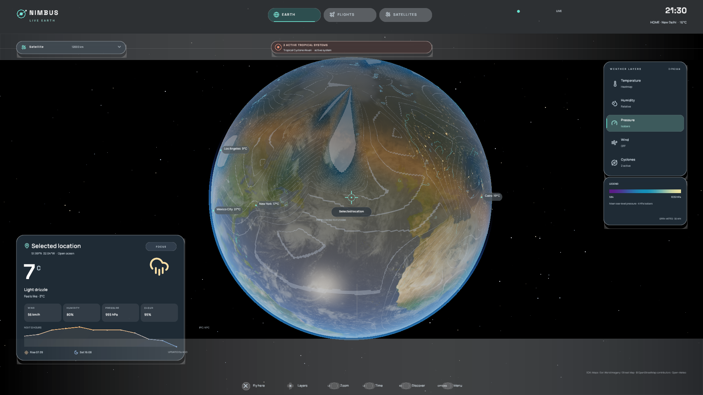
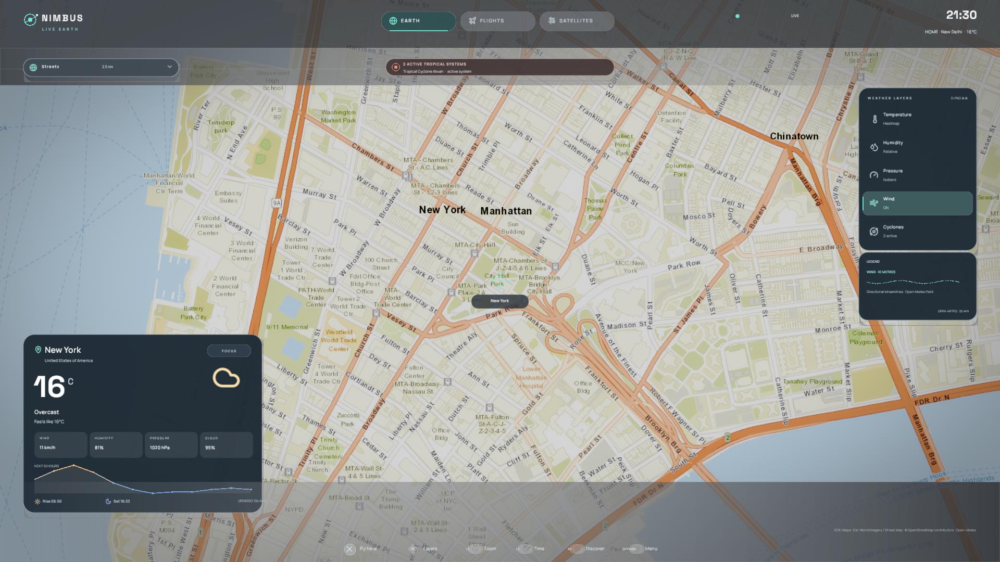
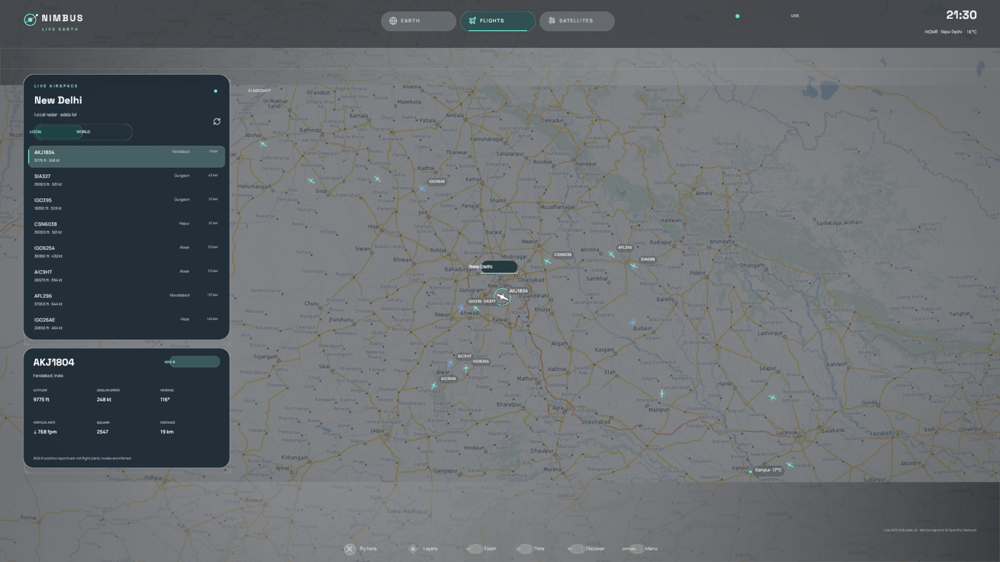
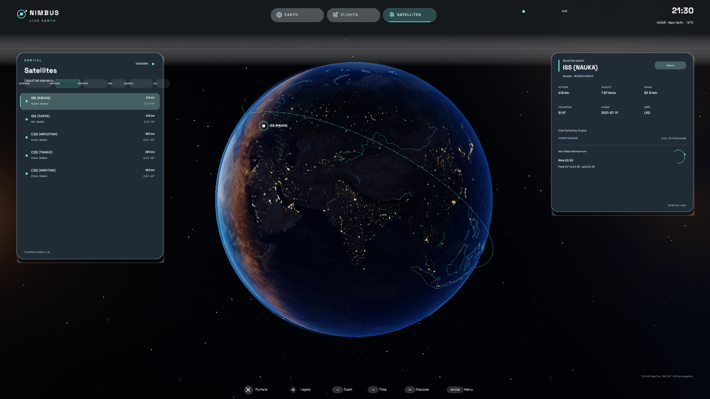
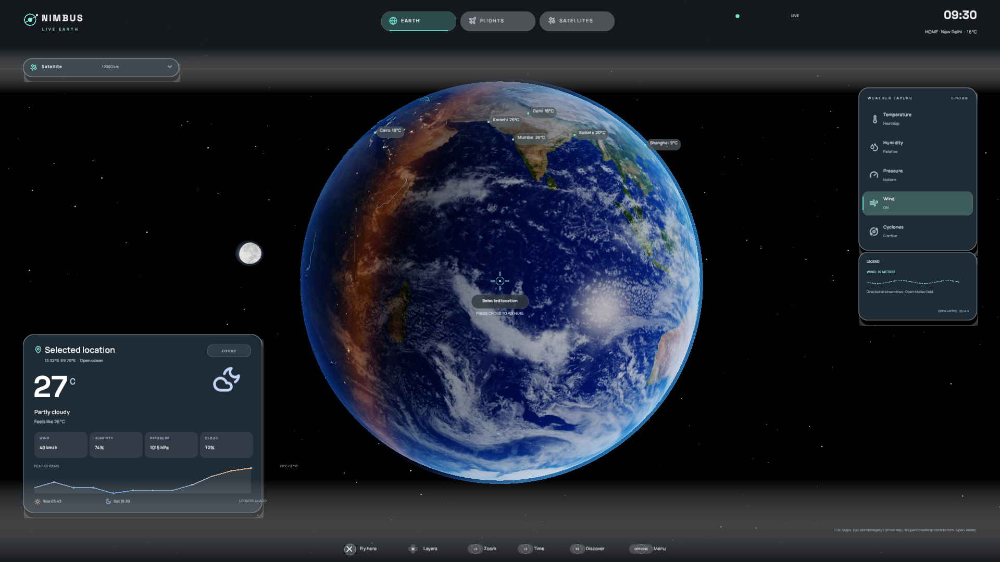

# Nimbus — Live Earth

A native **PlayStation 5** homebrew app that turns the console into a live
planet: a GPU-rendered Earth with real-time weather, seamless city-level zoom,
live aircraft and satellites, and a DualSense-first interface that doubles as a
screensaver.

**Title ID:** `PPSA42716` · **Version:** `01.000.000` · **Category:** Utilities  
**License:** GPL-3.0-or-later · **Developer:** MasterShivnath007



## What it does

| | |
| --- | --- |
| **Live Earth** | Day/night terminator, city lights, clouds, atmosphere, stars, and a physical Sun/Moon sky computed from UTC. |
| **Google Earth-style zoom** | Orbit the globe, then dive continuously into streamed satellite or street tiles. |
| **Weather layers** | Temperature, humidity, pressure (with isobars), animated 10 m wind, and tropical cyclones. |
| **Flights** | Live ADS-B aircraft around the selected region, with callsigns, altitude, speed, heading and nearest city. |
| **Satellites** | CelesTrak TLEs propagated with SGP4, country/owner, orbit paths, overhead list and next-pass prediction. |
| **Home city** | Choose the sky Nimbus opens on; search the full Natural Earth city set with a controller keyboard. |
| **Screensaver** | After a configurable idle time, the HUD disappears, the Earth drifts, and the weather keeps moving. |
| **Discover** | 34 cinematic destinations — from the Taj Mahal to the Antarctic Peninsula — one Cross press away. |






## Controls

| Input | Action |
| --- | --- |
| Left stick | Orbit the Earth / move the map |
| Right stick | Fine orbit; rotate the map heading on the surface |
| L2 / R2 | Zoom out / in, with light trigger rumble |
| Cross | Dive to the city under the reticle; choose list items |
| Circle | Pull back to orbit; close a panel |
| L1 / R1 | Cycle Earth → Flights → Satellites |
| D-pad ◂ ▸ | Cycle weather layer (temperature · humidity · pressure · off) |
| D-pad ▴ ▾ | Cycle map style (satellite · atlas · streets) |
| Square | Toggle wind streamlines |
| Triangle | Clean view / hide the HUD |
| L3 + right stick | Scrub the sky clock; release to return to live time |
| R3 | Fly to a surprise destination |
| Touchpad | Return home |
| Options | Open Settings |
| Mouse / keyboard | Desktop: drag to orbit, wheel to zoom, click UI, type in location search |

In Flights: D-pad selects an aircraft, Cross focuses it, Square toggles
local/world traffic, R1 rescans the visible airspace.  
In Satellites: D-pad selects, ◂ ▸ filters, Triangle toggles the orbit, Cross
frames the selected object.  
In Settings: D-pad navigates, ◂ ▸ adjusts, Cross changes.





## Data — free public sources

| Data | Source | License / terms |
| --- | --- | --- |
| Temperature, humidity, pressure, wind, point forecasts | [Open-Meteo](https://open-meteo.com/) | CC BY 4.0; free non-commercial API |
| Base Earth day/night/cloud imagery | [Solar System Scope](https://www.solarsystemscope.com/textures/) | CC BY 4.0, based on NASA data |
| Sentinel-2 cloudless, terrain and OSM raster | [EOX::Maps](https://maps.eox.at/) | EOX asks for attribution and a link back; data © OpenStreetMap contributors |
| High-zoom street and aerial tiles | [Esri World Street Map / World Imagery](https://www.arcgis.com/home/item.html?id=3b93337983e9436f8db950e38a8629af) | Esri basemap terms + attribution; confirm terms for your distribution |
| Live aircraft (local) | [adsb.lol](https://adsb.lol/) | Free community ADS-B API; attribution |
| World aircraft snapshot | [OpenSky Network](https://opensky-network.org/) | Non-commercial; attribution |
| Satellite TLEs | [CelesTrak](https://celestrak.org/) | Free GP data; attribution |
| Cyclones | [NASA EONET](https://eonet.gsfc.nasa.gov/) and [NOAA NHC](https://www.nhc.noaa.gov/) | Public / US Government |
| Cities, countries, borders | [Natural Earth](https://www.naturalearthdata.com/) | Public domain |
| Fonts | Manrope, Space Grotesk | SIL OFL 1.1 |
| Icons | [Lucide](https://lucide.dev/) | ISC |

Full credits and license texts are in [THIRD_PARTY_NOTICES.md](THIRD_PARTY_NOTICES.md)
and in the app's **Settings → Data sources** screen.

The app stores only settings and a tile cache on the console (`/download0/nimbus`).
There is no account, analytics or telemetry. Coordinates leave the console only
when a forecast, flight scan or tile is requested from the services above.

## Build — desktop

Requirements: CMake 3.20+, a C++20 compiler, SDL2, OpenGL 3.3, libcurl.

```bash
# macOS
brew install cmake sdl2
cmake -S . -B build -DCMAKE_BUILD_TYPE=RelWithDebInfo
cmake --build build -j8
./build/nimbus
```

```bash
# Ubuntu / Debian
sudo apt install cmake libsdl2-dev libcurl4-openssl-dev libgl1-mesa-dev
cmake -S . -B build -DCMAKE_BUILD_TYPE=RelWithDebInfo
cmake --build build -j"$(nproc)"
./build/nimbus
```

The first run opens the home-location picker. Assets are committed; the only
optional step is regenerating them:

```bash
python3 -m venv .venv
.venv/bin/pip install -r requirements-dev.txt
.venv/bin/python tools/fetch_assets.py --force
```

Headless screenshots used in this README:

```bash
./build/nimbus --screenshot out.png --width 1920 --height 1080 \
  --style satellite --lat 40.7 --lon -74 --alt 12000 --layer temp \
  --utc 2026-11-22T16:00:00 --wait 8
```

### Tests

```bash
cmake --build build --target nimbus_tests -j8
./build/nimbus_tests
```

## Build — PlayStation 5

Nimbus is a **native PS5 title** (`eboot.bin` + `sce_sys/param.json`), not an ELF
payload. It renders through the OpenGL 4.6 stack from
[ps5-opengl](https://github.com/blackbearreloaded/ps5-opengl) and is packaged by
the [ps5-native-app-boilerplate](https://github.com/blackbearreloaded/ps5-native-app-boilerplate).

See [BUILD-PS5.md](BUILD-PS5.md) and [ps5/build_ps5.sh](ps5/build_ps5.sh).
The included GitHub Actions workflow builds the title folder on Ubuntu and
uploads it as a build artifact. The release zip is attached manually so its
SHA-256 stays stable for the catalog.

> The PS5 build targets an already-configured homebrew environment. It is not
> affiliated with, endorsed by, or supported by Sony Interactive Entertainment.

## Store submission

The catalog record and a step-by-step submission checklist are in
[SUBMISSION.md](SUBMISSION.md) and [catalog/PPSA42716.json](catalog/PPSA42716.json).
ProsperoStore accepts only native titles whose artifact is a `.zip` of the title
folder, published as a GitHub release asset, with a pinned SHA-256 and a 512×512
icon.

## Architecture

```
src/
  app/            App state machine, screens, camera, settings, astro
  data/           JSON, HTTP workers, weather, flights, satellites, cyclones
  gfx/            OpenGL: globe, streamed tiles, sky, font atlas, UI, post
  platform/       SDL2 desktop + EGL/DualSense PS5
  ui/             Generated Lucide icon map
third_party/      stb, SGP4/SDP4 (public domain)
tools/            asset preparation and icon generation
ps5/              native title packaging script
sce_sys/          PS5 title metadata and launcher art
```

Highlights of the implementation:

- **Streamed single-LOD tile selection** from the actual screen footprint, with
  Esri detail tiles above zoom 14 and EOX Sentinel-2/OSM below.
- **Analytic camera raycasts** for tile coverage (no fragile matrix inversion in
  floating-point depth space).
- **Real solar and lunar ephemerides**; the terminator, city lights, stars and
  celestial directions all come from the same UTC clock.
- **Threaded libcurl / libSceHttp transport** with duplicate suppression,
  priority scheduling, disk cache and stale-cache fallback.
- **SGP4/SDP4** propagation and pass prediction running on the console.
- **Custom font atlas and SDF UI** in a single batched OpenGL pipeline, designed
  for a television and a controller.

## Known limitations

- City imagery depends on public tile services. EOX and Esri may rate-limit; the
  app caches aggressively and falls back to cached data.
- Esri basemap usage is suitable for a free non-commercial community app with
  attribution; re-check Esri's terms if you redistribute or sell the app.
- PS5 display mode is 1080p/60 in this release (the renderer supports higher
  internal resolution through the quality setting). The native title folder
  builds successfully with the pinned toolchain; it has not yet been launched
  on retail hardware.
- Surface views are intentionally north-up; the orbital view carries the sky,
  stars and celestial bodies.
- TLE snapshots are refreshed with releases. Live TLE refresh is on the roadmap.

## License

Nimbus' own source is **GPL-3.0-or-later**. Third-party components keep their own
licenses; see [THIRD_PARTY_NOTICES.md](THIRD_PARTY_NOTICES.md). The launcher backgrounds are generated by `tools/make_shell_art.py`; the
selection audio is GPL-3.0-or-later audio from the native-app boilerplate. The
Nimbus icon is original.
